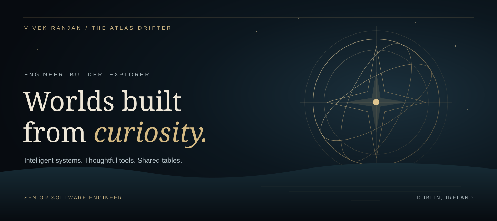

<a href="https://www.atlasdrifter.com">
  
</a>

<p align="center">
  <a href="https://www.atlasdrifter.com/work"><b>Behind the build ↗</b></a> &nbsp; / &nbsp;
  <a href="https://www.atlasdrifter.com/games"><b>The game table ↗</b></a> &nbsp; / &nbsp;
  <a href="https://www.atlasdrifter.com/travel"><b>Beyond the atlas ↗</b></a> &nbsp; / &nbsp;
  <a href="https://www.atlasdrifter.com/blog"><b>Field notes ↗</b></a>
</p>

<br />

# I'm Vivek. I turn curiosity into working systems.

Senior Software Engineer based in **Dublin, Ireland**, with approximately **5 years** building GenAI applications, agentic workflows, and cloud data platforms. My work spans enterprise pharmaceutical systems, a native graph execution engine, tools that keep documents local, and games made for a shared table.

**Python · C++ · FastAPI · LangGraph · AWS**

[Explore my portfolio](https://www.atlasdrifter.com/work) · [Read my résumé](https://www.atlasdrifter.com/Vivek_Ranjan_Resume.pdf) · [Connect on LinkedIn](https://www.linkedin.com/in/ranjanvivek19)

---

### 01 / BUILT TO WORK
## Intelligence, with an engine underneath.

### [GraphCore Studio ↗](https://github.com/vivek19398/graphcore-studio)
**A visual workspace for agentic workflows. A native runtime at its core.**

Build graphs with conditional routing, agent handoffs, Python tools, structured outputs, and human approval checkpoints. A C++17 execution engine connects to Python through a C ABI / ctypes bridge, with state management and crash-recoverable checkpoints.

`C++17` `Python` `Pydantic` `OpenRouter` `CMake`

```sh
pip install graphcore-studio
```

[Explore the source](https://github.com/vivek19398/graphcore-studio) · [Install from PyPI](https://pypi.org/project/graphcore-studio/)

### [AstraPDF ↗](https://github.com/vivek19398/AstraPDF)
**Your documents. Your machine.**

A Python PDF toolkit and local browser studio for merging, splitting, extracting, rotating, annotating, watermarking, cropping, and exporting documents. A loopback-only server and in-memory processing keep files local; PDFium rendering, lazy thumbnails, and page caching support large-document browsing.

`Python` `PDFium` `Local processing` `Python API + CLI`

```sh
pip install astrapdf
```

[Explore the source](https://github.com/vivek19398/AstraPDF) · [Install from PyPI](https://pypi.org/project/astrapdf/)

<details>
<summary><b>More experiments — retrieval, language, vision, and native apps</b></summary>

- [RAG-sakiladatabase](https://github.com/vivek19398/RAG-sakiladatabase) — retrieval and natural-language database querying.
- [Call_Summary](https://github.com/vivek19398/Call_Summary) — conversational transcript analysis and summarization.
- [PharmaBlister](https://github.com/vivek19398/PharmaBlister) — pharmaceutical blister-pack inspection with computer vision.
- [VocabiOSApp](https://github.com/vivek19398/VocabiOSApp) — a native iOS vocabulary app.
- [csep_permit_tracker](https://github.com/vivek19398/csep_permit_tracker) — an Ireland employment-permit queue tracker.

</details>

---

### 02 / MADE FOR COMPANY
## One more hand.

Some builds bring intelligence to a workflow. Others bring people to the same table.

| Game | The invitation | Take a seat |
| :--- | :--- | :--- |
| **♦ Dealz** | Big deals. Little cards. Your people. Real-time multiplayer for 2–5. | [Play ↗](https://dealgame.vercel.app/) · [Source](https://github.com/vivek19398/Deal) |
| **♠ Twenty-Nine** | Every trick counts. Four players, two teams, one winning hand. | [Play ↗](https://29game.vercel.app/) · [Source](https://github.com/vivek19398/29game) |
| **● Sequence** | Think a move ahead. Play against a bot or share a screen. | [Play ↗](https://sequence-family-table.ochre-wood-2173.chatgpt.site/) |
| **♣ Bhabhi / Tulla** | The last hand. A private table for 3–8, joined by invite code. | [Play ↗](https://thullacardgame.vercel.app/) · [Source](https://github.com/vivek19398/Thulla_Bhabhi) |

[Visit the game table ↗](https://www.atlasdrifter.com/games)

---

### 03 / EXPERIENCE AT SCALE
## From enterprise data to agentic systems.

**Eli Lilly and Company · Associate Consultant**<br />
Nov 2023 — Aug 2025 · Bengaluru

- Built BioSmartPlatform with RAG and Text-to-SQL across product documents, Redshift, and RDS, saving the analytics team **8+ hours per week**.
- Developed FastAPI and LangGraph services with input/output validation, topic classification, and PII detection.
- Scaled AWS reporting pipelines across **10M+ patient records and 150+ tables**, reducing manual operations by **40%**.
- Received **two Eli Lilly Rise Awards** in 2024.

**Dish Network Technologies · Software Engineer**<br />
Sep 2022 — Oct 2023 · Bengaluru

- Automated PySpark and AWS Glue workflows, recovering **40+ engineering hours per month**.
- Modernized **20+ reports** and integrated pipeline alerts to reduce support resolution time by **30%**.

**Cognizant Technology Solutions · Programmer Analyst**<br />
Jan 2021 — Sep 2022

- Built configuration-driven Python and GitHub Actions workflows for warehouse builds and auditing.
- Modelled insurance datasets with SQL, PySpark, and Snowflake.

[The full story ↗](https://www.atlasdrifter.com/work#experience)

<details>
<summary><b>Tools I work with</b></summary>

| Focus | Toolkit |
| :--- | :--- |
| **AI systems** | RAG, LangChain, LangGraph, LangSmith, MCP, OpenAI API, Amazon Bedrock, PyTorch, Pydantic, guardrails and evaluation |
| **Backend & runtime** | Python, C++17, FastAPI, SQL, REST APIs, CMake |
| **Cloud & data** | AWS Lambda, Glue, ECS, S3, Redshift, RDS, PySpark, Snowflake, Azure Data Factory, Databricks, Airflow, Kafka |
| **Shipping** | Docker, GitHub Actions, Jenkins, CI/CD |

</details>

<details>
<summary><b>Education & credentials</b></summary>

- **M.Eng. in Artificial Intelligence** — University of Limerick, 2025–2026. First Class Honours; GPA 3.55/4.0.
- **B.E. in Computer Science & Engineering** — Panjab University, 2017–2021.
- **IBM RAG and Agentic AI** — Coursera, 2026.
- **Microsoft Certified: Azure Fundamentals (AZ-900).**

</details>

---

### 04 / BEYOND THE BUILD
## There is always another horizon.

Away from the editor, the atlas keeps growing: places, photographs, stories, and the things you notice when you take a different route.

[Explore the travel journal ↗](https://www.atlasdrifter.com/travel) · [Read the field notes ↗](https://www.atlasdrifter.com/blog)

---

<p align="center"><sub>THE NEXT CHAPTER</sub></p>
<h2 align="center">Every good story starts with a conversation.</h2>
<p align="center">
  <a href="mailto:vivek000@outlook.com"><b>Send a raven ↗</b></a><br /><br />
  <a href="https://www.atlasdrifter.com">Portfolio</a> &nbsp; · &nbsp;
  <a href="https://www.linkedin.com/in/ranjanvivek19">LinkedIn</a> &nbsp; · &nbsp;
  <a href="https://pypi.org/user/atlas.drifter/">PyPI</a> &nbsp; · &nbsp;
  <a href="https://www.atlasdrifter.com/Vivek_Ranjan_Resume.pdf">Résumé</a>
</p>
<p align="center"><sub>VIVEK RANJAN / THE ATLAS DRIFTER / DUBLIN, IRELAND</sub></p>
