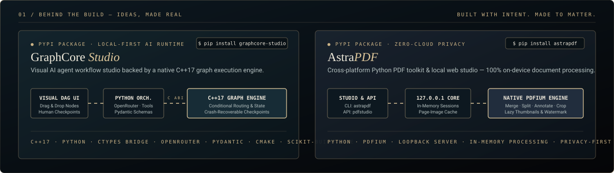
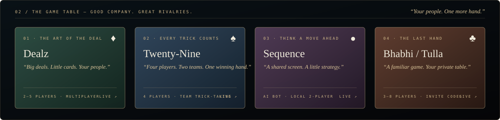

<div align="center">

<!-- ═══════════════════════════════════════════════════════════════════════════
     I · THE ARRIVAL — HERO BANNER (THE ATLAS DRIFTER · VIVEK RANJAN)
     ═══════════════════════════════════════════════════════════════════════════ -->
<a href="https://www.atlasdrifter.com">
  
</a>

<br />

<!-- Animated Typing Subtitle -->
<a href="https://www.atlasdrifter.com/work">
  
</a>

<br />

<!-- Realm & Social Navigation Badges -->
<p align="center">
  <a href="https://www.atlasdrifter.com">
    
  </a>
  <a href="https://www.atlasdrifter.com/work">
    
  </a>
  <a href="https://www.atlasdrifter.com/games">
    
  </a>
  <a href="https://www.atlasdrifter.com/travel">
    
  </a>
</p>

<p align="center">
  <a href="https://www.linkedin.com/in/ranjanvivek19">
    
  </a>
  <a href="https://pypi.org/user/atlas.drifter/">
    
  </a>
  <a href="https://leetcode.com/u/viveksinha00/">
    
  </a>
  <a href="https://www.atlasdrifter.com/Vivek_Ranjan_Resume.pdf">
    
  </a>
  <a href="mailto:vivek000@outlook.com">
    
  </a>
  
</p>

</div>


<!-- ═══════════════════════════════════════════════════════════════════════════
     00 / THE PERSON BEHIND IT ALL — EXECUTIVE SNAPSHOT
     ═══════════════════════════════════════════════════════════════════════════ -->

```yaml
name: "Vivek Ranjan (The Atlas Drifter)"
role: "Senior Software Engineer — GenAI, Agentic AI & Cloud Data Platforms"
base: "Dublin, Ireland 🇮🇪 (Stamp 1G — Full Work Authorization, No Sponsorship Required)"
education: "M.Eng. in Artificial Intelligence @ University of Limerick (First Class Honours · 3.55/4.0 GPA)"

what_i_build:
  - "Local-First AI & Developer Tooling  → C++17 graph engines, Python/FastAPI runtimes, PyPI packages"
  - "Enterprise GenAI & Agentic Systems  → Multi-agent LangGraph workflows, RAG, Text-to-SQL, HIPAA/GDPR Guardrails"
  - "Cloud-Scale Data Platforms          → AWS (S3, Glue, Redshift, Lambda, ECS), PySpark & Snowflake (10M+ records)"
  - "Multiplayer Web Games               → Real-time card & strategy tables built for friends and family"
```


<!-- ═══════════════════════════════════════════════════════════════════════════
     01 / BEHIND THE BUILD — IDEAS, MADE REAL (OPEN-SOURCE & PYPI PACKAGES)
     ═══════════════════════════════════════════════════════════════════════════ -->

<div align="center">
  <a href="https://www.atlasdrifter.com/work#projects">
    
  </a>
</div>

<br />

<table width="100%">
  <tr>
    <td width="50%" valign="top">
      <h3>
        <a href="https://github.com/vivek19398/graphcore-studio">✧ GraphCore Studio</a>
        &nbsp;
        <a href="https://pypi.org/project/graphcore-studio/">
          
        </a>
      </h3>
      <p>
        <b>Local-first visual AI agent workflow platform</b> with drag-and-drop DAG editing, conditional routing, multi-agent handoffs, structured-output validation, and human approval checkpoints.
      </p>
      <pre lang="bash"><code>pip install graphcore-studio</code></pre>
      <p>
        
        
        
        
        
        
      </p>
      <details>
        <summary><b>🔬 Inspect System Architecture &amp; Engineering Highlights</b></summary>
        <br />
        <ul>
          <li><b>Native C++17 Graph Execution Engine:</b> Bridges to Python via a low-overhead <code>C ABI / ctypes</code> layer for deterministic workflow scheduling and state transitions.</li>
          <li><b>Crash-Recoverable Checkpoints:</b> Persists intermediate execution state and human-in-the-loop approval gates so long-running agent graphs resume seamlessly.</li>
          <li><b>Zero-Dependency Browser Studio:</b> Packaged with <code>CMake</code> and <code>scikit-build-core</code> for one-command installation and local execution.</li>
        </ul>
        <p>
          <a href="https://github.com/vivek19398/graphcore-studio"><b>GitHub Repository ↗</b></a> ·
          <a href="https://pypi.org/project/graphcore-studio/"><b>PyPI Package ↗</b></a>
        </p>
      </details>
    </td>
    <td width="50%" valign="top">
      <h3>
        <a href="https://github.com/vivek19398/AstraPDF">✧ AstraPDF</a>
        &nbsp;
        <a href="https://pypi.org/project/astrapdf/">
          
        </a>
      </h3>
      <p>
        <b>Privacy-first cross-platform Python PDF toolkit &amp; local web studio</b> for merging, splitting, extracting, rotating, reordering, annotating, watermarking, and cropping documents 100% on-device.
      </p>
      <pre lang="bash"><code>pip install astrapdf &amp;&amp; astrapdf</code></pre>
      <p>
        
        
        
        
        
      </p>
      <details>
        <summary><b>🔬 Inspect System Architecture &amp; Engineering Highlights</b></summary>
        <br />
        <ul>
          <li><b>Strict Local-Only Architecture:</b> Uses a loopback-only web server (<code>127.0.0.1</code>) and in-memory processing — sensitive documents never leave your machine.</li>
          <li><b>High-Speed PDFium Rendering:</b> Features lazy thumbnail generation, page-image caching, and short-lived in-memory sessions for responsive large-document manipulation.</li>
          <li><b>Dual Interface:</b> Exposes both a scriptable Python API (<code>pdfstudio</code> module) and an interactive browser studio via the <code>astrapdf</code> CLI launcher.</li>
        </ul>
        <p>
          <a href="https://github.com/vivek19398/AstraPDF"><b>GitHub Repository ↗</b></a> ·
          <a href="https://pypi.org/project/astrapdf/"><b>PyPI Package ↗</b></a>
        </p>
      </details>
    </td>
  </tr>
</table>

<details>
  <summary><b>📂 Explore More Engineering Repositories (RAG, Computer Vision, NLP &amp; iOS)</b></summary>
  <br />
  <table width="100%">
    <thead>
      <tr>
        <th align="left">Repository</th>
        <th align="left">Domain &amp; Stack</th>
        <th align="left">Overview</th>
      </tr>
    </thead>
    <tbody>
      <tr>
        <td><a href="https://github.com/vivek19398/RAG-sakiladatabase"><b>RAG-sakiladatabase</b></a></td>
        <td><code>Python</code> · <code>RAG</code> · <code>Text-to-SQL</code></td>
        <td>Retrieval-Augmented Generation &amp; natural-language relational database querying over the Sakila schema.</td>
      </tr>
      <tr>
        <td><a href="https://github.com/vivek19398/Call_Summary"><b>Call_Summary</b></a></td>
        <td><code>Python</code> · <code>NLP</code> · <code>LLMs</code></td>
        <td>Automated conversational transcript analysis, key-point extraction, and structured call summarization pipeline.</td>
      </tr>
      <tr>
        <td><a href="https://github.com/vivek19398/csep_permit_tracker"><b>csep_permit_tracker</b></a></td>
        <td><code>Web</code> · <code>Analytics</code></td>
        <td>Ireland Critical Skills Employment Permit (CSEP) processing queue tracker and timeline visualizer.</td>
      </tr>
      <tr>
        <td><a href="https://github.com/vivek19398/VocabiOSApp"><b>VocabiOSApp</b></a></td>
        <td><code>Swift</code> · <code>iOS</code></td>
        <td>Native iOS vocabulary builder and spaced-repetition learning companion built with Swift.</td>
      </tr>
      <tr>
        <td><a href="https://github.com/vivek19398/PharmaBlister"><b>PharmaBlister</b></a></td>
        <td><code>Computer Vision</code> · <code>Deep Learning</code></td>
        <td>Automated pharmaceutical blister-pack defect inspection and quality assurance using deep learning.</td>
      </tr>
    </tbody>
  </table>
</details>


<!-- ═══════════════════════════════════════════════════════════════════════════
     02 / THE GAME TABLE — GOOD COMPANY. GREAT RIVALRIES.
     ═══════════════════════════════════════════════════════════════════════════ -->

<div align="center">
  <a href="https://www.atlasdrifter.com/games">
    
  </a>
</div>

<br />

> *"Sometimes turning complex ideas into things people can actually use means an intelligent application. Sometimes it means **one more hand** with friends."*

| Suit & No. | Game | Tagline | Players & Mode | Play Live | Source |
| :--- | :--- | :--- | :--- | :---: | :---: |
| **♦ 01** | **Dealz** | *THE ART OF THE DEAL* — Big deals. Little cards. Your people. | `2–5 Players` · Real-time Multiplayer | [**Play Dealz ↗**](https://dealgame.vercel.app/) | [Repo](https://github.com/vivek19398/Deal) |
| **♠ 02** | **Twenty-Nine** | *EVERY TRICK COUNTS* — Four players. Two teams. One winning hand. | `4 Players` · 2v2 Trick-Taking | [**Play 29 ↗**](https://29game.vercel.app/) | [Repo](https://github.com/vivek19398/29game) |
| **● 03** | **Sequence** | *THINK A MOVE AHEAD* — A shared screen. A little strategy. | `AI Bot / Local 2P` · Strategy Board | [**Play Sequence ↗**](https://sequence-family-table.ochre-wood-2173.chatgpt.site/) | [Portal](https://www.atlasdrifter.com/games) |
| **♣ 04** | **Bhabhi / Tulla** | *THE LAST HAND* — A familiar game. Your private table. | `3–8 Players` · Private Invite Codes | [**Play Tulla ↗**](https://thullacardgame.vercel.app/) | [Repo](https://github.com/vivek19398/Thulla_Bhabhi) |


<!-- ═══════════════════════════════════════════════════════════════════════════
     03 / THE ARSENAL — TECH STACK & ENGINEERING CAPABILITIES
     ═══════════════════════════════════════════════════════════════════════════ -->

### `03 / THE ARSENAL` — Technical Capabilities

<table width="100%">
  <tr>
    <td width="28%"><b>🧠 Generative AI &amp; Agentic Systems</b></td>
    <td>
      
      
      
      
      
      
      
      
      
      
      
      
      
    </td>
  </tr>
  <tr>
    <td><b>⚙️ Languages &amp; Core Backend</b></td>
    <td>
      
      
      
      
      
      
      
      
      
    </td>
  </tr>
  <tr>
    <td><b>☁️ Cloud Platforms (AWS &amp; Azure)</b></td>
    <td>
      
      
      
      
      
      
      
      
      
      
      
    </td>
  </tr>
  <tr>
    <td><b>📊 Data Engineering &amp; Analytics</b></td>
    <td>
      
      
      
      
      
      
      
      
    </td>
  </tr>
  <tr>
    <td><b>🚀 DevOps &amp; Delivery</b></td>
    <td>
      
      
      
      
      
    </td>
  </tr>
</table>


<!-- ═══════════════════════════════════════════════════════════════════════════
     04 / THE JOURNEY — EXPERIENCE, EDUCATION & HONOURS
     ═══════════════════════════════════════════════════════════════════════════ -->

### `04 / THE JOURNEY` — Production Impact & Academic Pedigree

<details open>
  <summary><b>🏛️ Eli Lilly and Company · Associate Consultant</b> <i>(Nov 2023 – Aug 2025)</i> &nbsp;·&nbsp; 🏆 <b>2× Eli Lilly Rise Award Winner</b></summary>
  <br />
  <blockquote>
    <i>Intelligent analytics, agentic backend services, and enterprise data platforms for global pharmaceutical programs.</i>
  </blockquote>
  <ul>
    <li><b>BioSmartPlatform (GenAI &amp; Text-to-SQL):</b> Engineered using <code>LangChain</code>, <code>Python</code>, and <code>AWS</code> for <b>Tempo (Diabetes)</b>, <b>Lilly Health (Zepbound &amp; Mounjaro)</b>, and <b>Lilly Together (Immunology)</b> — combining RAG over product PDFs with Text-to-SQL queries against Amazon Redshift &amp; RDS, saving the analytics team <b>8+ hours/week</b>.</li>
    <li><b>Consensus / RedStrike (Agentic APIs &amp; Guardrails):</b> Built high-concurrency RESTful APIs with <code>FastAPI</code>, <code>Python</code>, and <code>LangGraph</code>, integrating an LLM agentic framework and AI guardrails for input/output validation, topic classification, and PII detection to enforce <b>HIPAA / GDPR</b> compliance.</li>
    <li><b>10M+ Patient Record Pipelines:</b> Built and scaled Zepbound and Diabetes reporting pipelines across <b>150+ tables</b> on <code>AWS S3</code>, <code>Glue</code>, and <code>Redshift</code>, cutting manual operations by <b>40%</b> and achieving <b>99% uptime</b>.</li>
    <li><b>Data Warehouse Consolidation:</b> Unified multiple SQL Data Warehouse tables with SCD Type 1 &amp; Type 2 tracking, boosting reconciliation accuracy and efficiency by <b>90%</b>.</li>
    <li><b>Honours:</b> Awarded the <b>Eli Lilly Rise Award (Q1 2024)</b> for innovation in data infrastructure and the <b>Eli Lilly Rise Award (Q4 2024)</b> for exceptional productivity and delivery.</li>
  </ul>
</details>

<details>
  <summary><b>📡 Dish Network Technologies (EchoStar Corporation) · Software Engineer</b> <i>(Sep 2022 – Oct 2023)</i></summary>
  <br />
  <ul>
    <li><b>Automated PySpark &amp; AWS Glue ETL:</b> Eliminated manual data-processing overhead and recovered <b>40+ engineering hours per month</b>.</li>
    <li><b>Supply-Chain Modernization:</b> Modernized <b>20+ warehouse and supply-chain reports</b> for El Paso and Denver operations using Python and SQL, improving reporting efficiency by <b>~20%</b>.</li>
    <li><b>End-to-End Orchestration &amp; Alerting:</b> Built automated pipelines in <code>Azure Data Factory V2</code> with <code>Power BI</code> monitoring and <code>ServiceNow</code> incident integration, reducing support resolution time by <b>30%</b>.</li>
  </ul>
</details>

<details>
  <summary><b>🏢 Cognizant Technology Solutions · Programmer Analyst</b> <i>(Jan 2021 – Sep 2022)</i></summary>
  <br />
  <ul>
    <li><b>Config-Driven CI/CD Framework:</b> Built an automated <code>GitHub Actions</code> + <code>Python</code> framework for daily builds, updates, and auditing of warehouse transactional tables.</li>
    <li><b>Snowflake Star-Schema Modelling:</b> Designed fact and dimension tables for a Commercial Insurance dataset using <code>SQL</code>, <code>PySpark</code>, and <code>Snowflake</code>.</li>
  </ul>
</details>

<details>
  <summary><b>🎓 Education &amp; Certifications · M.Eng. in Artificial Intelligence (First Class Honours)</b></summary>
  <br />
  <ul>
    <li><b>Master of Engineering in Artificial Intelligence</b> — <i>University of Limerick, Ireland</i> (2025 – 2026) · <b>First Class Honours (GPA: 3.55 / 4.0)</b></li>
    <li><b>Bachelor of Engineering in Computer Science &amp; Engineering</b> — <i>Panjab University, India</i> (2017 – 2021)</li>
    <li><b>Certifications:</b> <code>IBM RAG and Agentic AI</code> (Coursera · 2026) &nbsp;|&nbsp; <code>Microsoft Certified: Azure Fundamentals (AZ-900)</code></li>
  </ul>
</details>


<!-- ═══════════════════════════════════════════════════════════════════════════
     05 / TELEMETRY — GITHUB METRICS & CONTRIBUTION SNAKE
     ═══════════════════════════════════════════════════════════════════════════ -->

### `05 / TELEMETRY` — Activity & Open-Source Pulse

<div align="center">
  
  
</div>

<div align="center">
  
  
</div>

<br />

<!-- Automated Contribution Snake (Generated by .github/workflows/snake.yml) -->
<div align="center">
  <picture>
    <source media="(prefers-color-scheme: dark)" srcset="https://raw.githubusercontent.com/vivek19398/vivek19398/output/github-snake-dark.svg" />
    <source media="(prefers-color-scheme: light)" srcset="https://raw.githubusercontent.com/vivek19398/vivek19398/output/github-snake-dark.svg" />
    
  </picture>
</div>


<!-- ═══════════════════════════════════════════════════════════════════════════
     FOOTER — EVERY GOOD STORY STARTS WITH A CONVERSATION
     ═══════════════════════════════════════════════════════════════════════════ -->

<div align="center">
  <sub><code>EVERY GOOD STORY STARTS WITH A CONVERSATION</code></sub>
  <h3>
    <a href="https://www.atlasdrifter.com/work#contact">Send a <i>raven.</i> ↗</a>
  </h3>
  <p>
    <a href="https://www.atlasdrifter.com"><b>atlasdrifter.com</b></a> &nbsp;·&nbsp;
    <a href="https://www.linkedin.com/in/ranjanvivek19"><b>LinkedIn</b></a> &nbsp;·&nbsp;
    <a href="https://pypi.org/user/atlas.drifter/"><b>PyPI</b></a> &nbsp;·&nbsp;
    <a href="https://www.atlasdrifter.com/Vivek_Ranjan_Resume.pdf"><b>Résumé</b></a> &nbsp;·&nbsp;
    <a href="mailto:vivek000@outlook.com"><b>vivek000@outlook.com</b></a>
  </p>
  <sub>© Vivek Ranjan · <b>THE ATLAS DRIFTER</b> · Crafted with intent in Dublin, Ireland</sub>
</div>
